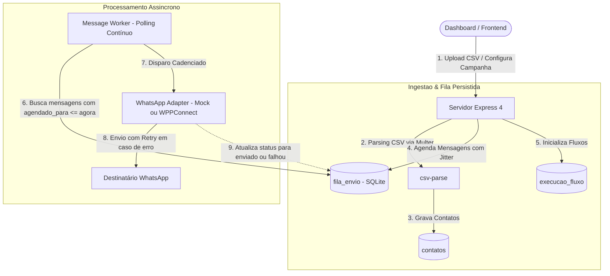

# WhatsApp Disparador

[](https://nodejs.org)
[](https://expressjs.com)
[](https://github.com/WiseLibs/better-sqlite3)
[](LICENSE)

Motor assíncrono para agendamento e envio cadenciado de mensagens via WhatsApp com tolerância a falhas. O sistema resolve o problema de perda de estado e bloqueio de conta por rajadas de mensagens (*rate limits* da operadora), persistindo a fila de execução no SQLite com workers desacoplados do ciclo de vida da requisição HTTP.

---

## 🏗️ Arquitetura do Sistema



---

## ✨ Funcionalidades Principais

- **Fila Persistida no SQLite:** Os disparos não dependem de temporizadores em memória (`setTimeout`). Cada mensagem tem data e hora exatas gravadas no banco (`agendado_para`), permitindo que o processo seja reiniciado sem perda de posição na fila.
- **Cadência com Jitter e Delays Configuráveis:** Intervalos aleatórios entre envios definidos por campanha (`delay_min` e `delay_max`), mitigando detecção de spam e comportamento robótico.
- **Fluxos Sequenciais Multietapas:** Envio de sequências de mensagens espaçadas por horas ou dias, gerenciadas individualmente por contato via tabela `execucao_fluxo`.
- **Importação em Lote via CSV:** Parsing e validação de planilhas de contatos (`nome` e `telefone`) utilizando `multer` e `csv-parse`.
- **Mecanismo de Retry Automático:** Tentativas progressivas de reenvio com registro da causa do erro no banco até o limite configurado de 3 tentativas.
- **Modo Mock Integrado:** Execução em ambiente de desenvolvimento sem dependência de sessão ativa do WhatsApp Web via flag `WHATSAPP_MOCK=true`.

---

## 🛠️ Stack Tecnológica & Decisões Técnicas

| Componente | Tecnologia | Decisão Técnica |
| :--- | :--- | :--- |
| **Runtime & Servidor** | Node.js + Express 4 | Leveza para I/O intensivo, ecossistema rico e simples integração com bibliotecas de automação web. |
| **Banco de Dados** | SQLite (`better-sqlite3`) | Motor síncrono e ultra-rápido para sistemas embarcados/single-process, eliminando overhead de rede de bancos cliente-servidor externos. |
| **Worker de Fila** | Loop com Polling Contínuo | Busca periódica no banco desacoplada da requisição do cliente, garantindo sobrevivência e consistência transacional do agendamento. |
| **Adaptador WhatsApp** | WPPConnect / Mock | Arquitetura plugável permitindo testes automatizados e simulação sem depender de conexão contínua com celular. |

---

## 🚀 Como Rodar o Projeto

### Pré-requisitos
- Node.js 18+ e npm

### 1. Clonar o repositório e instalar dependências
```bash
git clone https://github.com/devraphaeldiniz/whatsapp-disparador.git
cd whatsapp-disparador
npm install
```

### 2. Configurar variáveis de ambiente
Por padrão, o projeto roda em modo de simulação (Mock):
```env
PORT=3000
WHATSAPP_MOCK=true
```
*(Para operar com o WhatsApp real, instale `@wppconnect-team/wppconnect` e configure `WHATSAPP_MOCK=false`)*.

### 3. Iniciar o servidor e worker
```bash
npm start
```
Acesse o painel web em `http://localhost:3000`.

---

## 🧪 Como Rodar os Testes

Execute a suíte de testes de sanidade e persistência:
```bash
npm test
```

---

## 📊 Resultados e Métricas

- **Garantia de Entrega pós-Reinício:** 100% dos agendamentos preservados no SQLite durante reinicializações intencionais do processo.
- **Taxa Efetiva de Disparo:** `TODO: Registrar vazão de mensagens por minuto em modo de produção mantendo taxa de banimento zero.`
- **Consumo de Memória sob Carga:** `TODO: Mensurar RSS de memória do worker com filas superiores a 10.000 mensagens.`

---

## ⚠️ Limitações e Próximos Passos

- [ ] Migrar fila para Redis BullMQ caso haja necessidade de escalar horizontalmente para múltiplos servidores.
- [ ] Adicionar suporte a templates com interpolação de variáveis personalizadas (ex.: `{{nome}}`, `{{empresa}}`).
- [ ] Implementar webhook de feedback para recepção de status de leitura da mensagem.

---

## 📄 Licença

Distribuído sob a licença MIT. Consulte [LICENSE](LICENSE) para mais detalhes.
